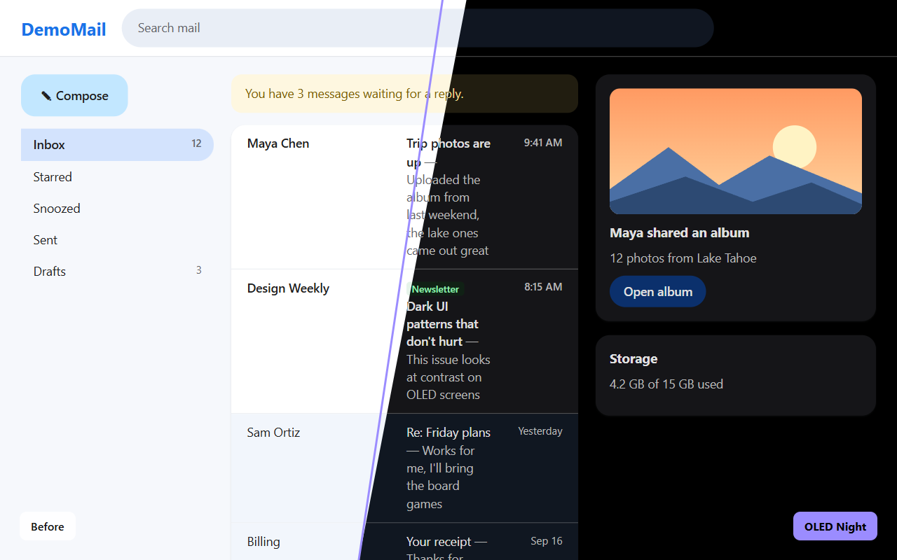
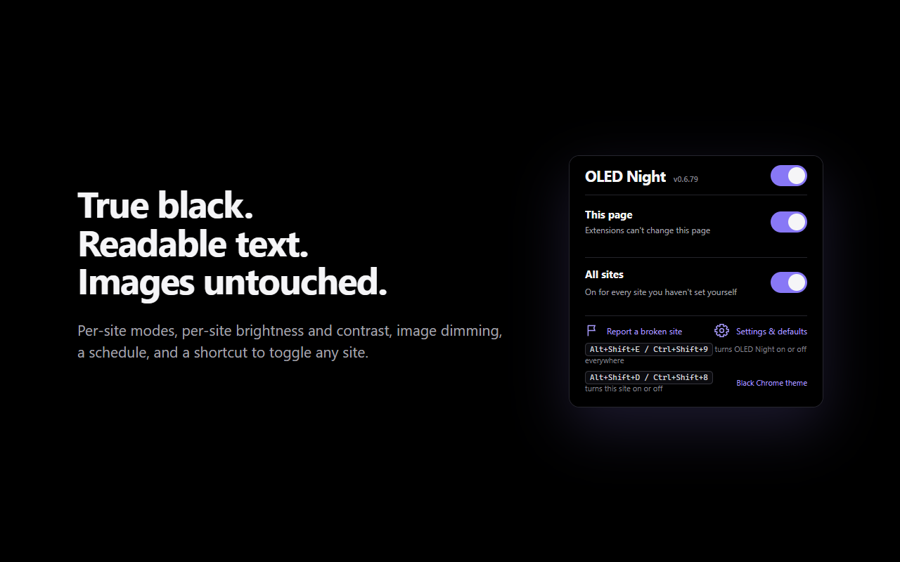

<p align="center"></p>

<h1 align="center">OLED Night</h1>

<p align="center"><b>True-black (#000000) dark mode for every website, in Chrome and Firefox.</b><br>
Free and open source · readable text · images preserved · per-site control</p>

<p align="center">
  <a href="https://chromewebstore.google.com/detail/oled-night/afffgalhockmjmknnaljghdneaeichbl"><b>Chrome Web Store</b></a> ·
  <a href="https://addons.mozilla.org/en-US/firefox/addon/oled-night/"><b>Firefox Add-ons</b></a> ·
  <a href="https://chromewebstore.google.com/detail/oled-night-chrome-theme/pkdklfocgpcnijiggfddneadmhacbpmf">Companion Chrome theme</a> ·
  <a href="https://bc1224.github.io/oled-night/">Website</a> ·
  <a href="https://github.com/bc1224/oled-night/releases/latest/download/oled-night.zip">Download ZIP</a> ·
  <a href="INSTALL.md">Install guide</a>
</p>

**Latest version:** 0.6.79, November 2026 ([changelog](CHANGELOG.md), [all releases](https://github.com/bc1224/oled-night/releases)).

Most dark modes paint pages dark gray (around `#121212`). OLED Night paints page backgrounds true black, `#000000`. On an OLED or AMOLED screen a black pixel is switched off, so true black means deeper contrast, no gray glow in a dark room and less power drawn by the panel. Text stays readable, and photos, video and artwork keep their original colors.



## Why
I've got an OLED monitor, and I wanted every site to be black. Not dark grey. Actually black, so the pixels are off.

Every dark mode extension I tried either left everything grey, or made sites dark and broke them: text I couldn't read, random white boxes, weird white gradients around chat boxes, charts turning into blank white shapes, Amazon photos turning into black squares. Some even made Gmail and ChatGPT lag. So I made my own. Every time a site broke, I fixed it and added a test so it stays fixed.

## Features
- **True `#000` black backgrounds.** Cards and panels keep a subtle lift so layouts stay readable.
- **Images untouched.** Photos, video and art keep their colors. Image dimming is optional.
- **Readable text, with emphasis kept.** Primary, secondary and muted text stay distinct, and Gmail's read and unread emails stay easy to tell apart.
- **Respects dark sites.** On a site that's already dark, it only deepens its greys to true black.
- **Modern web apps.** Charts, web components, embedded chat widgets and frames, and modern CSS colors (`oklch`, `lab`, `color()`).
- **No white flash.** Pages go black before they draw, and updates are batched.
- **Per-site modes:** automatic, full recolor, deepen blacks only, invert (canvas apps), or off. Each site can also have its own brightness, contrast and image dimming.
- **Keyboard shortcuts:** <kbd>Alt</kbd>+<kbd>Shift</kbd>+<kbd>E</kbd> turns OLED Night on or off everywhere; <kbd>Alt</kbd>+<kbd>Shift</kbd>+<kbd>D</kbd> toggles the current site. Both are customizable in your browser's extension shortcut settings.
- **Schedule and settings backup.** Export or restore your settings, including per-site choices.
- **Optional private screenshot reports.** Capture the current page, paste, drop or select an image, review it, and explicitly submit it privately to the maintainer. The public tracking issue has a generic title unless you pick a problem type; then it shows the site domain, that type, the extension version and color mode. No GitHub account is required.
- **Native colors for design tools.** Figma stays in its original colors, including when you explicitly enable a site rule.
- **Readable logos.** Dark logo lettering can be lightened without an outside glow while bright brand accents and product images stay protected.
- **No automatic analytics or background tracking.** The extension does not log your browsing history. Settings stay in browser storage and can sync through your browser profile. Optional reports share the previewed domain and technical diagnostics, plus any notes or screenshot you choose to include, privately with the maintainer for up to 30 days. The public GitHub tracking issue shows a generic title, or the site domain, problem type, extension version and color mode if you pick a problem type. See the [privacy policy](store/PRIVACY.md).

## How it differs from filter-based dark modes
Filter-based dark modes invert the whole page with a CSS filter, then try to invert images back. OLED Night does not use a page-wide filter.
- **Per-element recoloring.** Each background, text color, border, icon, chart fill, gradient and shadow gets its own dark color, so layouts keep their structure and text keeps its emphasis.
- **Images preserved.** Photos, video, artwork and brand colors are left alone instead of being double-inverted. Image dimming is optional.
- **No white flash.** Pages are black before they first draw, and later updates are batched into a single style pass.
- **Already-dark sites respected.** On a site that is already dark, OLED Night only deepens its grays to true black.

## Performance
Measured with the repo's own benchmark (`tests/e2e/benchmark.mjs`) in headless Chrome 156 on Windows 11, plain Chrome versus OLED Night 0.6.79, three runs each, medians shown. Full method and history: [PERFORMANCE.md](PERFORMANCE.md).

| Test page | Plain Chrome | With OLED Night |
|---|---|---|
| Simple light page: page load | 26 ms | 33 ms |
| Simple light page: page work while animating for 3 s | 20 ms | 19 ms |
| 2,500-row inbox-style page, 20 rows changing every frame for 3 s: page work | 494 ms | 603 ms (about 22% more) |
| Same page: frames drawn in 3 s / worst frame gap | 181 / 18 ms | 179 / 18 ms |
| Same page: page script memory | 0.9 MiB | 6.8 MiB |

What this means in practice:
- On ordinary pages the cost is within run-to-run noise.
- On very large, constantly changing pages OLED Night does real extra work, because it recolors each new or changed element. In these runs that did not drop frames.
- The first recolor of a very large page can delay its load event (2,500 rows: about 0.75 s in two of three runs, 42 ms in the third).
- OLED Night is not always lighter than other dark modes. In an earlier test (0.6.10) on the same 2,500-row page it used more CPU than Dark Reader.
- Reported slowdowns get fixed with measurements. For example, 0.6.13 cut typing lag on Discord from 48 to 72 ms per key press to 0.4 ms.

Pages that keep their own design colors (Figma, sites you set to **Off**) skip the recoloring work entirely.

## Tested and working on
Every reported breakage gets a regression fixture that runs in real headless Chrome (and Firefox for most lab scenarios) before each release. Current fixtures are modeled on:
- **Email and docs:** Gmail (inbox rows, read/unread, large stylesheets), Google Docs, Google Sheets, Google Analytics
- **Video and music:** YouTube (player, live chat, descriptions), YouTube Music
- **AI chat:** ChatGPT (streaming replies and controls)
- **Shopping and services:** Amazon search and storefronts, CVS, Booking-style forms and calendars, checkout pages, Apple account and Apple Ads controls, App Store icons, California DMV
- **Social:** Instagram controls, Reddit (including Reddit Enhancement Suite)
- **Building blocks:** web components and shadow roots, embedded frames, consent banners, charts, canvas apps, logos, dropdowns and verification widgets

These are local reproductions, not live logins. Live checks are run on reported sites when a fix ships.

**Known issues and the per-site fix**
| Situation | What to do |
|---|---|
| A canvas app (spreadsheet grid, drawing tool) stays light | Set that site's mode to **Invert** |
| Google Docs canvas artwork shows dark display colors | Use **Deepen blacks only** or **Off** while checking original colors (saved documents and exports are unchanged) |
| Figma | Keeps its native design colors by design |
| A site you want left exactly as designed | Set that site to **Off** (Alt+Shift+D) |
| Browser pages (`chrome://`, the Chrome Web Store, Firefox add-on pages) | Browsers block extensions there; the companion Chrome theme darkens Chrome's own window |
| Captcha and verification widgets | Intentionally left unchanged so verification keeps working |
| Something else looks wrong | Use **Report a broken site** in the popup |

## Permissions, plainly
- **Website access (all sites):** needed to read each page's colors and recolor it on your device. A dark mode that covers every site has to run on every site.
- **Storage:** saves your settings and per-site choices in your browser's storage, which can sync through your browser profile. The developer cannot see them.
- **activeTab and scripting:** let the popup and shortcuts identify the current site and check whether a tab can be reached. No code is injected into the page's own scripts.
- **Clipboard (optional):** asked only when you choose to paste a screenshot into a report.

What OLED Night never does: no analytics, no ads, no background telemetry, no account, and no browsing-history log. Recoloring happens locally and never uploads page text or anything you type. Bug reports are optional and private: nothing is sent until you choose **Submit report**, report contents are readable only by the maintainer for up to 30 days, and the public GitHub tracking issue shows only a generic title, or the site domain, problem type, extension version and color mode if you pick a problem type. Full details: [privacy policy](store/PRIVACY.md).

## Recommended settings for OLED monitors
- **Mode:** Automatic. Light sites are recolored and already-dark sites only get deeper blacks.
- **Text brightness:** 80 to 90% (the default is 88). Fully white text on true black can look harsh in a dark room and adds wear to the brightest subpixels.
- **Image dimming:** off, unless you browse image-heavy sites late at night.
- **Burn-in care:** let your monitor's pixel refresh run, auto-hide the taskbar and avoid leaving static, bright browser UI on screen for hours. True-black pages help because unlit pixels do not age.
- **Ambient light:** in a bright room, raise Surface contrast so panels and cards stay distinct.
- **Browser window:** websites are only half the screen. Install the [OLED Night Chrome theme](https://chromewebstore.google.com/detail/oled-night-chrome-theme/pkdklfocgpcnijiggfddneadmhacbpmf) to turn Chrome's tabs and toolbar black too.

## Install
Install the [OLED Night extension](https://chromewebstore.google.com/detail/oled-night/afffgalhockmjmknnaljghdneaeichbl) from the Chrome Web Store. For a matching black browser window, install the [OLED Night Chrome theme](https://chromewebstore.google.com/detail/oled-night-chrome-theme/pkdklfocgpcnijiggfddneadmhacbpmf) too. Store installs update automatically.

**Manual install:**
Download [`oled-night.zip`](https://github.com/bc1224/oled-night/releases/latest/download/oled-night.zip), unzip it into a folder you'll keep, open `chrome://extensions`, turn on **Developer mode**, and click **Load unpacked** on that folder. Full steps, including Edge and updating, are in [INSTALL.md](INSTALL.md). To hear about new versions, click **Watch → Custom → Releases** at the top of this page.

**Want Chrome itself black too?** The extension darkens websites, but only a theme can change Chrome's own window. Grab [`oled-night-theme.zip`](https://github.com/bc1224/oled-night/releases/latest/download/oled-night-theme.zip) and load it the same way. See [theme/README.md](theme/README.md).

**Firefox desktop:** Install from [Mozilla Add-ons](https://addons.mozilla.org/en-US/firefox/addon/oled-night/) or see [Firefox installation](FIREFOX.md) for manual builds. The Chrome theme is not compatible with Firefox.

## Using it
Click the toolbar icon on any site:

The switch beside **OLED Night** and **Alt+Shift+E** pause or resume the extension everywhere, including sites with a forced mode. Your site rules, tuning, appearance and schedule are preserved; resuming restores them, so sites saved as Off stay off. The existing **All sites** switch controls the default for sites without their own rule. The site shortcut leaves rules unchanged while the extension is paused. Alternate keys are **Ctrl+Shift+9** for the whole extension and **Ctrl+Shift+8** for the current site (Command replaces Ctrl on macOS). The popup and Settings show the keys your browser actually assigned. If none are assigned, use **Settings & defaults → Change shortcuts** to assign them.



| Site mode | What it does |
|---|---|
| Use global | Follows the main switch |
| On (automatic) | Recolors light sites; on dark sites, only deepens their blacks |
| Full recolor | Always recolors, even if the site looks dark |
| Deepen blacks only | Only pushes the darkest greys to true black |
| Invert | For compatible canvas apps, such as spreadsheets: flips the page, then flips images back. Figma always keeps its native colors |
| Off | Never touches the site |

Google Docs document pages use dark display colors in Automatic and Full recolor. This also changes the displayed colors of artwork embedded in the document canvas. Choose Deepen blacks only or Off when checking original document colors. Saved documents and exports keep their original colors.

If a site still looks wrong, click **Report a broken site** in the popup. Add optional notes, then choose **Screenshot this page** or paste, drop or select an image. Review the image and choose **Use screenshot**. Nothing is uploaded until you choose **Submit report**. The reporting service stores your scrubbed diagnostics, notes and any screenshot privately for up to 30 days, accessible only with the maintainer's GitHub authentication. It creates a public tracking issue with a generic title, or with the site domain, problem type, extension version and color mode if you pick a problem type. Your notes, diagnostics and screenshot link are never published. No GitHub sign-in is required to submit. A success popup confirms submission. Anything you manually add to a public GitHub issue or comment is public. Fixes require reproduction, tests and review. Full local report downloads can contain visible text and identifiers, so review them before sharing.

## How it works
OLED Night doesn't run one filter over the whole page. It works out a color for each element on its own: backgrounds, text, borders, SVG icons, chart fills, gradients, shadows and `::before`/`::after`. It keeps each text's original emphasis and remembers what was originally behind it. Every update reads all the styles it needs first and writes the changes after, so a batch costs a single style recalculation. Brightness and contrast are CSS variables, so moving a slider never re-scans the page.

| File | Role |
|---|---|
| `settings.js` | Shared settings model: defaults, site modes, per-site tuning, schedule |
| `color-utils.js` | Color parsing (every CSS color syntax) and mapping rules |
| `content.js` | Page engine: batched recoloring, change tracking, shadow roots, invert mode, reports |
| `background.js` | Keyboard shortcut; removes the page script older versions registered |
| `popup.*`, `options.*` | Toolbar popup and settings page |
| `docs/` | The project website (GitHub Pages) |

## Development
No build step. Load the folder with **Load unpacked**, then:
```
for t in tests/*.test.js; do node "$t"; done   # unit tests
node tests/e2e/run.mjs                          # real extension in headless Chrome
node tools/package.mjs                          # dist/ zips for the extension and the theme
node tools/store-assets.mjs                     # screenshots for the README and website
```
See [CONTRIBUTING.md](CONTRIBUTING.md) and [CHANGELOG.md](CHANGELOG.md).

## License
[GPL-3.0](LICENSE). You're free to use, study, change and share OLED Night. If you distribute a modified version, or charge for it, you must release its full source code under the same license and keep the original credit. Copyright © 2026 Brandon (bc1224). Versions up to 0.6.3 were released under MIT.

### Site controls and design tools

The popup starts with this site's on/off switch and its own **Text brightness** and **Surface contrast** sliders. **All sites** below holds defaults; existing site choices take priority. **Use defaults** clears the current site's custom mode, sliders and image setting. Advanced rendering modes remain available in an expandable section.

Text brightness changes recolored text, not monitor brightness. Surface contrast changes mapped panels and borders, not pure black backgrounds. Already-dark pages in Deepen blacks mode keep their original colors; choose Full recolor if you want the sliders to change them.

Figma uses its native colors by default, avoiding recoloring work and protecting design colors. Even when explicitly turned on, Figma remains in native-color protection mode: recoloring, inversion, image dimming and tuning are bypassed. It is not forced to OLED black. Native color inputs and explicitly identifiable color-picker/swatch controls are excluded from recoloring. Arbitrary custom controls cannot always be identified.
